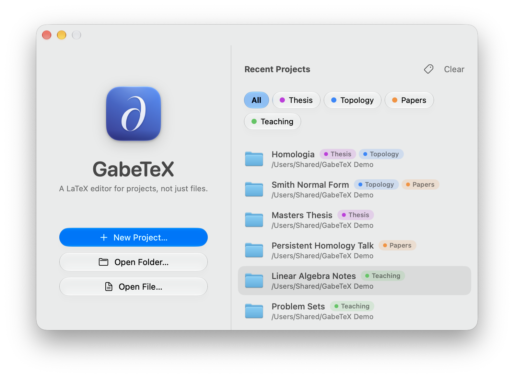

<p align="center">
  
</p>

<h1 align="center">GabeTeX</h1>

<p align="center">
  <b>A native macOS LaTeX editor for projects, not just files.</b><br>
  Live compilation while you type, a built-in PDF with precise two-way sync, and an interface that feels like it belongs on macOS 26.
</p>

<p align="center">
  <a href="https://github.com/gabe-rbo/GabeTeX/releases/latest"></a>
  <a href="LICENSE"></a>
  
  
  <a href="https://github.com/gabe-rbo/GabeTeX/actions/workflows/ci.yml"></a>
</p>

<p align="center">
  <a href="https://github.com/gabe-rbo/GabeTeX/releases/latest/download/GabeTeX.dmg"></a>
</p>

<p align="center">
  <a href="https://gabe-rbo.github.io/GabeTeX/">Website</a> ·
  <a href="https://github.com/gabe-rbo/GabeTeX/releases">All releases</a> ·
  <a href="CHANGELOG.md">Changelog</a> ·
  <a href="CONTRIBUTING.md">Contributing</a> ·
  <a href="README.pt-BR.md">Português (Brasil)</a>
</p>

<p align="center">
  
</p>

---

## Why GabeTeX

GabeTeX was written by a mathematician who keeps every paper as `main.tex` plus one file per section, and
wanted an editor that treats that as the normal case. It has three goals:

1. **Beautiful and native.** SwiftUI and AppKit, the Liquid Glass look of macOS 26, Light and Dark mode, SF Mono
   in the editor. No web view, no Electron, no third-party dependencies.
2. **Projects, not files.** Open a folder and get a file tree, tabs, Quick Open, a document outline that spans
   every included file, and ⌘-click navigation through `\input`, `\include` and `\ref`.
3. **It adapts to your TeX.** GabeTeX finds the TeX distribution you already have, compiles in the background
   while you type, puts the errors on the right line of the right file, and offers to install missing packages.

## Features

### Projects and navigation
- Open any folder, or create a project from a template (Article, Article with Sections, Thesis, Beamer
  Presentation, Math Notes, Problem Set).
- File tree sidebar, tabs, **Quick Open (⌘P)**, and a **document outline across all included files**.
- ⌘-click `\input{…}` / `\include{…}` to open the file; ⌘-click `\ref{…}` to jump to its `\label`.
- Built for one-file-per-section writing: `% !TEX root` and `% !TEX program` magic comments, plus automatic
  root-document detection.
- Respects file encodings (UTF-8 and Latin-1 detection, with an encoding indicator), saves atomically while
  preserving file metadata, and notices when a file changes on disk.

### Compiling
- Detects **MacTeX, TeX Live, BasicTeX and TinyTeX**; compiles with `latexmk` using pdfLaTeX, XeLaTeX or LuaLaTeX.
- **Compiles in the background while you type**, including text you have not saved yet, in a private shadow
  copy of the project. Your files are not touched until you save. See [how it works](#how-live-compilation-works).
- Errors and warnings from the TeX log and from ChkTeX are underlined at the right line of the right file,
  including inside section files, and collected in an Issues panel.
- Missing package? GabeTeX offers to install it with `tlmgr` (asking for the administrator password when the
  distribution needs it).
- ⌘B saves and exports the PDF next to `main.tex`; ⇧⌘K cleans auxiliary files.

### PDF preview and sync
- Built-in PDF preview (PDFKit) with SyncTeX that keeps your page and zoom across reloads.
- **Precise two-way sync** *(new in 1.1)*: double-click a word in the PDF to land on that exact word in the
  source (or switch to ⌘-click in Settings); ⌘-click text in the editor, or use **Show in PDF** (⇧⌘J), to land
  on that exact word in the PDF. The destination is briefly highlighted. An optional **Follow cursor in PDF**
  setting keeps the PDF in step as you move the caret.
- **Detachable PDF** *(new in 1.1)*: pop the preview out into its own window for a second display or full
  screen, and re-dock it any time. Reloads, sync and the build shortcuts all keep working.

<p align="center">
  
</p>

### Writing
- Autocomplete for commands, environments, `\ref` / `\cite` keys, file names and packages, with snippets.
- Syntax highlighting, line numbers, auto-pairing, auto-closing of `\begin`…`\end`, comment toggling.
- Optional **Vim mode**: normal, insert, visual and visual-line modes, operators and text objects (including
  `i$` / `a$` for math and `ie` / `ae` for environments), `:w :wa :q :make`, search and substitute. Dead keys on
  ABNT2 and US-International layouts work.
- The interface is available in **English and Brazilian Portuguese** and follows the system language.

### Organizing projects
- **Project labels** *(new in 1.1)* on the Welcome window: color labels, filter chips, search. Labeled projects
  never fall off the recents list. Labels live in the app and never touch your project folders.

### Touch Bar
- **Touch Bar support** *(new in 1.1)* on Macs that have one: compile and stop, Show in PDF, shortcuts for math and
  for sections and environments, scrubbers for Greek letters and math symbols, and page and zoom controls when the PDF
  has focus. Customize it under **View › Customize Touch Bar…**.

<p align="center">
  
</p>

## Requirements

- **macOS 26 (Tahoe) or later** on an **Apple Silicon** Mac.
- A **TeX distribution**. [MacTeX](https://tug.org/mactex/) is recommended; BasicTeX and TinyTeX work too, and
  missing packages can be installed from inside the app.

## Installation

1. **[Download GabeTeX.dmg](https://github.com/gabe-rbo/GabeTeX/releases/latest/download/GabeTeX.dmg)**. The
   link always points to the newest release. The [website](https://gabe-rbo.github.io/GabeTeX/) lists **all
   versions**, with release notes and a download link for each, and updates itself as new releases are published.
2. Open the disk image and drag **GabeTeX** onto the **Applications** folder.
3. Install a TeX distribution if you do not have one yet ([MacTeX](https://tug.org/mactex/)).

### First launch: "Open Anyway"

GabeTeX is ad-hoc signed but **not notarized**: notarization needs a paid Apple Developer ID, and this is a
free, open-source project. The first time you open it, macOS says it cannot verify the app. That is expected,
and you only have to deal with it once:

- Open **System Settings › Privacy & Security**, scroll to the **Security** section, click **Open Anyway** next to
  GabeTeX, and confirm.
- Or, in Terminal, remove the quarantine flag and open the app normally:

  ```sh
  xattr -dr com.apple.quarantine /Applications/GabeTeX.app
  ```

If you would rather not trust a binary, read the code and [build it yourself](#building-from-source).

## Getting started

1. **Open a project.** On the Welcome window choose **New Project…** (pick a template) or **Open Folder…**.
   Opening a single `.tex` file opens its folder as the project.
2. **Split your document into sections.** Keep `main.tex` and put each section in `sections/*.tex`, pulled in with
   `\input{sections/introduction}`. At the top of each section file add a root comment so GabeTeX (and other
   TeX editors) know which document it belongs to:

   ```latex
   % !TEX root = ../main.tex
   ```

   Use `% !TEX program = xelatex` (or `lualatex`) at the top of `main.tex` to pick the engine. GabeTeX also finds
   the root document by itself, and you can pin one with **Build › Set as Main Document**.
3. **Move around.** Switch the sidebar between **Files** and **Outline**, press **⌘P** to open any file by name, and
   ⌘-click an `\input{…}` or a `\ref{…}` to follow it.
4. **Just write.** The PDF updates in the background as you type. Problems are underlined in the editor and
   listed in the Issues panel (⇧⌘M). Press **⌘B** to save everything and export the PDF next to `main.tex`.
5. **Jump between source and PDF.** Double-click a word in the PDF, or ⌘-click text in the editor.
6. **Try the sample.** The repository ships a small multi-file project in
   [`Examples/Homologia`](Examples/Homologia) (`main.tex`, `sections/*.tex`, `refs.bib` and a `tikz-cd`
   diagram, written in Portuguese). Open that folder in GabeTeX to see live compilation, the outline and sync
   in action.

## Keyboard shortcuts

| Action | Shortcut |
|---|---|
| Compile (saves and exports the PDF next to `main.tex`) | ⌘B |
| Stop compiling | ⌘. |
| Quick Open: jump to any file in the project | ⌘P |
| Source → PDF: **Show in PDF** (forward search) | ⇧⌘J |
| Source → PDF: jump to the clicked word | ⌘-click text in the editor |
| PDF → source: jump to the clicked word | Double-click a word in the PDF *(or ⌘-click, see Settings › General)* |
| Open the file of `\input{…}` / go to the `\label` of a `\ref{…}` | ⌘-click the argument |
| Next / previous issue | ⌘' / ⇧⌘' |
| Show / hide the PDF · Issues panel | ⌥⌘P · ⇧⌘M |
| Files / Outline in the sidebar | ⌥⌘1 / ⌥⌘2 |
| Toggle comment on the selected lines | ⌘/ |
| Indent / outdent | ⌘] / ⌘[ |
| Autocomplete | ⌃Space (or automatic after typing `\`) |
| Find · Find and Replace · Go to line | ⌘F · ⌥⌘F · ⌘L |
| New project · Open folder · Open file | ⇧⌘N · ⌘O · ⌥⌘O |
| New file · Save · Save all | ⌘N · ⌘S · ⌥⌘S |
| Tabs: next / previous · jump to tab N | ⌃⇥ / ⌃⇧⇥ · ⌘1 … ⌘9 |
| Clean auxiliary files | ⇧⌘K |

The detached PDF window is under **View › Open PDF in Separate Window** (and **Attach PDF to Project Window** to
dock it again). Vim mode is switched on in **Settings › Editor**.

## How live compilation works

While you type, GabeTeX compiles a **private shadow copy** of your project, kept in
`~/Library/Caches/io.github.gabe-rbo.GabeTeX/Shadow/`. Every file in the copy is a symlink to your real file,
except the ones with unsaved edits, which are written out exactly as they are in the editor. So:

- your files are **never modified** until you save, and the compiler can never write into them;
- unsaved text takes part in the build, so errors appear as you type;
- the shadow also mirrors a few folders above the project, so `\input{../macros}` and `\bibliography{../refs}`
  work as they do on disk (edits you have not saved in files *outside* the project folder are not picked up until
  you save them);
- the build output is kept between runs, so recompiles are incremental;
- a project `.latexmkrc` is honoured;
- TeX processes are stopped as soon as you cancel or quit.

Errors and warnings are read from the TeX log and mapped back to your real files and lines. ⌘B additionally copies
the PDF next to your root document.

## Troubleshooting

**macOS says it cannot verify "GabeTeX".** See [First launch: "Open Anyway"](#first-launch-open-anyway).

**"No TeX distribution found."** Install [MacTeX](https://tug.org/mactex/), then reopen the project. If TeX lives in
an unusual place, set its `bin` folder in **Settings › TeX**.

**A package is missing.** Use the **Install** button in the banner. GabeTeX runs `tlmgr` and asks for your
administrator password if the distribution needs it. You can also install it yourself with
`sudo tlmgr install <package>`.

**`biber` fails to run.** Documents that use `biblatex` with `backend=biber` need a working `biber`. If it fails to
run, update it:

```sh
sudo tlmgr update --self && sudo tlmgr update biber
```

If it still fails, reinstall your TeX distribution, or switch to `\usepackage[backend=bibtex]{biblatex}` / `natbib`.

**Live compilation is slow or distracting.** Turn off **Compile while typing**, or raise the delay, in
**Settings › General**; ⌘B always works.

**The wrong file is compiled.** Add `% !TEX root = ../main.tex` to your section files, or choose
**Build › Set as Main Document**.

**Something looks stale.** The shadow copy is only a cache. Quit GabeTeX and delete
`~/Library/Caches/io.github.gabe-rbo.GabeTeX/Shadow/`; it is rebuilt on the next compile.

**Found a bug?** Please [open an issue](https://github.com/gabe-rbo/GabeTeX/issues) and attach the LaTeX log (the
**Log** tab of the Issues panel) and, if you can, a minimal project that reproduces it. See
[CONTRIBUTING.md](CONTRIBUTING.md#reporting-bugs).

## Known limitations

- VoiceOver support for the editor text is still incomplete.
- Unsaved edits in files outside the project folder (for example `../macros.tex`) are not part of the live
  compile; the version on disk is used until you save.
- Vim mode has no visual-block mode (⌃V), macros (`q` / `@`), or `:g` / `:normal` / `:sort`.
- Installing packages through `tlmgr` from the app has had limited real-world testing, because it asks for an
  administrator password. A full MacTeX install already includes almost everything.
- Only Apple Silicon builds are published.

## Building from source

You only need the **Command Line Tools** (`xcode-select --install`). Full Xcode is **not** required, and GabeTeX is
a plain Swift package with no third-party dependencies.

```sh
git clone https://github.com/gabe-rbo/GabeTeX.git
cd GabeTeX

swift build                      # debug build of every module
swift run GabeTeX                # run without packaging

Scripts/build-app.sh             # release build → build/GabeTeX.app (ad-hoc signed)
Scripts/build-app.sh --install   # …and copy it to ~/Applications
```

### Running the checks

XCTest and swift-testing ship only with full Xcode, so the tests are plain executables built on a tiny assertion
harness (`CheckKit`). Each prints a summary and exits non-zero on failure:

```sh
swift run TeXCoreChecks         # tokenizer, scanner, project index, completion
swift run VimKitChecks          # the Vim engine
swift run EditorKitChecks       # headless NSTextView editing behaviour
swift run TeXToolchainChecks    # log parser, shadow workspace, end-to-end compiles (needs MacTeX)
```

`TeXToolchainChecks --unit` runs only the suites that do not need a TeX installation; `--offline` skips the ones
that need the network.

## Architecture

A short tour; the full write-up is in [ARCHITECTURE.md](ARCHITECTURE.md).

| Module | What it does |
|---|---|
| `TeXCore` | Pure Swift: models, LaTeX tokenizer, project scanning (includes, outline, labels, bibliography), structural linter, autocomplete engine |
| `TeXToolchain` | TeX distribution detection, shadow-workspace compilation with `latexmk`, log parser, ChkTeX, `tlmgr`, SyncTeX |
| `EditorKit` | The TextKit 1 editor: highlighting, gutter, diagnostics, completion popup, snippets, Vim adapter, reveal highlights |
| `VimKit` | UI-independent Vim emulation |
| `PreviewKit` | PDFKit viewer with position-preserving reloads, highlights and sync clicks |
| `GabeTeX` | The SwiftUI app: windows, project workspace, sidebar, tabs, Quick Open, Issues, Settings, Welcome window |
| `CheckKit` + `*Checks` | The assertion harness and the check executables that replace XCTest |

## Contributing

Bug reports, ideas and pull requests are welcome, in **English or Portuguese**. Start with
[CONTRIBUTING.md](CONTRIBUTING.md) for the development setup and conventions, and
[ARCHITECTURE.md](ARCHITECTURE.md) for how the modules fit together.

## License

GabeTeX is released under the [MIT License](LICENSE). Copyright © 2026 Gabriel Ribeiro.

## Acknowledgements

GabeTeX stands on the shoulders of excellent open-source tools, none of which are affiliated with this project:

- [TeX Live](https://tug.org/texlive/) and [MacTeX](https://tug.org/mactex/): the TeX distributions GabeTeX drives.
- [latexmk](https://ctan.org/pkg/latexmk) by John Collins, which runs the build.
- [SyncTeX](https://ctan.org/pkg/synctex) by Jérôme Laurens, which maps between source and PDF.
- [ChkTeX](https://www.nongnu.org/chktex/) for LaTeX linting.
- Apple's [PDFKit](https://developer.apple.com/documentation/pdfkit), SwiftUI and AppKit.
