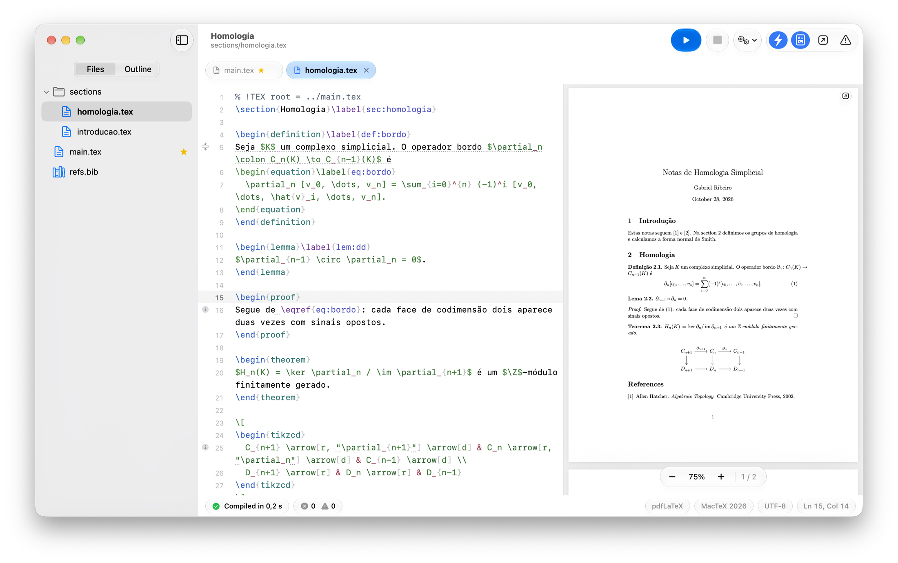

<p align="center">
  
</p>

<h1 align="center">GabeTeX para macOS</h1>

<p align="center">
  <i>Parte do projeto GabeTeX: veja <a href="https://github.com/gabe-rbo/GabeTeX">https://github.com/gabe-rbo/GabeTeX</a> e o site <a href="https://gabe-rbo.github.io/GabeTeX">https://gabe-rbo.github.io/GabeTeX</a>.</i>
</p>

<p align="center">
  <b>Um editor LaTeX nativo para macOS, feito para projetos e não só para arquivos.</b><br>
  Compilação ao vivo enquanto você digita, PDF integrado com sincronização precisa nos dois sentidos e uma interface que parece ter nascido no macOS 26.
</p>

<p align="center">
  <a href="https://github.com/gabe-rbo/GabeTeX-macOS/releases/latest"></a>
  <a href="LICENSE"></a>
  
  
  <a href="https://github.com/gabe-rbo/GabeTeX-macOS/actions/workflows/ci.yml"></a>
</p>

<p align="center">
  <a href="https://github.com/gabe-rbo/GabeTeX-macOS/releases/latest/download/GabeTeX.dmg"></a>
</p>

<p align="center">
  <a href="https://gabe-rbo.github.io/GabeTeX/">Site</a> ·
  <a href="https://github.com/gabe-rbo/GabeTeX">Projeto GabeTeX</a> ·
  <a href="https://github.com/gabe-rbo/GabeTeX-macOS/releases">Todas as versões</a> ·
  <a href="CHANGELOG.md">Histórico de mudanças</a> ·
  <a href="CONTRIBUTING.md">Como contribuir</a> ·
  <a href="README.md">English</a>
</p>

<p align="center">
  
</p>

---

## Por que o GabeTeX

O GabeTeX foi escrito por um matemático que guarda cada artigo como um `main.tex` mais um arquivo por seção e queria
um editor que trate isso como o caso normal. Ele tem três objetivos:

1. **Nativo e bonito.** SwiftUI e AppKit, o visual Liquid Glass do macOS 26, modo claro e escuro, SF Mono no editor.
   Sem web view, sem Electron, sem dependências de terceiros.
2. **Projetos, não arquivos.** Abra uma pasta e tenha árvore de arquivos, abas, *Quick Open*, uma estrutura do
   documento que atravessa todos os arquivos incluídos e navegação com ⌘-clique em `\input`, `\include` e `\ref`.
3. **Se adapta ao seu TeX.** O GabeTeX encontra a distribuição TeX que você já tem, compila em segundo plano enquanto
   você digita, mostra os erros na linha certa do arquivo certo e oferece instalar os pacotes que faltam.

## Recursos

### Projetos e navegação
- Abra qualquer pasta ou crie um projeto a partir de um template (Artigo, Artigo com Seções, Tese, Apresentação
  Beamer, Notas de Matemática, Lista de Exercícios).
- Barra lateral com árvore de arquivos, abas, **Quick Open (⌘P)** e uma **estrutura do documento que atravessa todos
  os arquivos incluídos**.
- ⌘-clique em `\input{…}` / `\include{…}` abre o arquivo; ⌘-clique em `\ref{…}` leva ao `\label` correspondente.
- Pensado para escrever uma seção por arquivo: comentários mágicos `% !TEX root` e `% !TEX program`, além da
  detecção automática do documento principal.
- Respeita a codificação dos arquivos (detecção de UTF-8 e Latin-1, com indicador de codificação), salva de forma
  atômica preservando os metadados e percebe quando um arquivo muda no disco.

### Compilação
- Detecta **MacTeX, TeX Live, BasicTeX e TinyTeX**; compila com o `latexmk` usando pdfLaTeX, XeLaTeX ou LuaLaTeX.
- **Compila em segundo plano enquanto você digita**, inclusive o texto que ainda não foi salvo, numa cópia privada
  (*shadow copy*) do projeto. Seus arquivos não são tocados até você salvar. Veja
  [como funciona](#como-a-compilação-ao-vivo-funciona).
- Erros e avisos do log do TeX e do ChkTeX aparecem sublinhados na linha certa do arquivo certo, inclusive dentro
  dos arquivos de seção, e ficam reunidos no painel de Problemas.
- **Avisos ao vivo de referências e citações**: um `\ref` para um rótulo que não existe, um rótulo definido mais de
  uma vez ou uma chave de `\cite` ausente da sua bibliografia aparecem sublinhados enquanto você digita, em todos os
  arquivos do projeto. (Os avisos de citação só aparecem quando o projeto tem uma bibliografia, e projetos que usam
  `xr` não passam pela checagem de referências.)
- Faltou um pacote? O GabeTeX oferece instalá-lo com o `tlmgr` (pedindo a senha de administrador quando a
  distribuição exigir).
- ⌘B salva e exporta o PDF ao lado do `main.tex`; ⇧⌘K limpa os arquivos auxiliares.

### PDF e sincronização
- Visualizador de PDF integrado (PDFKit) com SyncTeX, que mantém sua página e seu zoom a cada recarga.
- **Sincronização precisa nos dois sentidos**: dê um duplo clique numa palavra do PDF para cair exatamente nessa
  palavra no código (ou mude para ⌘-clique nos Ajustes); dê ⌘-clique num texto do editor, ou use **Mostrar no PDF**
  (⇧⌘J), para cair exatamente nessa palavra no PDF. O destino é destacado brevemente. A opção **Acompanhar o cursor
  no PDF** faz o PDF seguir, discretamente, o trecho que você está editando.
- **PDF destacável**: tire a prévia para uma janela própria, para usar um segundo monitor ou a tela cheia, e encaixe
  de volta quando quiser. Recargas, sincronização e atalhos de compilação continuam funcionando.

<p align="center">
  
</p>

### Apresentações
- **Modo apresentação para Beamer** (⌥⌘↩, ou o botão **Apresentar** na barra de ferramentas de um documento Beamer): a
  plateia vê os slides em tela cheia no monitor externo, e você tem uma **visão do apresentador** na sua tela, com o
  slide atual e o próximo, contador de slides, cronômetro, relógio e notas. Com um só monitor, a tecla **P** alterna
  a visão do apresentador. O layout de “notas na segunda tela” do Beamer é dividido para você, telas preta e branca
  ficam a uma tecla de distância e as recargas ao vivo mantêm o slide em que você está. Veja as
  [teclas da apresentação](#durante-uma-apresentação).

### Escrita
- Autocompletar para comandos, ambientes, chaves de `\ref` / `\cite`, nomes de arquivos e pacotes, com *snippets*.
  **O Tab completa** por padrão: aperte Tab depois de um comando incompleto ou dentro de `\ref{…}`, `\cite{…}` ou
  `\begin{…}`; o ⌃Espaço também sempre funciona.
- **Contagem de palavras e páginas** na barra de status e um popover de **Estatísticas do Documento** com as palavras
  e as páginas de cada seção (as páginas aparecem depois que o PDF é gerado); a barra lateral de Estrutura mostra a
  contagem de palavras de cada seção.
- **Paleta de Comandos** (⇧⌘P) para encontrar e executar qualquer comando pelo nome, e **atalhos de teclado
  editáveis** em **Ajustes › Atalhos**.
- Realce de sintaxe, números de linha, fechamento automático de pares, fechamento de `\begin`…`\end` e alternância de
  comentários.
- **Modo Vim** opcional: modos normal, inserção, visual e visual de linha, operadores e objetos de texto (incluindo
  `i$` / `a$` para matemática e `ie` / `ae` para ambientes), `:w :wa :q :make`, busca e substituição. Funciona com
  teclas mortas nos teclados ABNT2 e US-Internacional.
- A interface está em **português (Brasil) e inglês** e segue o idioma do sistema.

### Organização de projetos
- **Rótulos de projeto** na janela de boas-vindas: rótulos coloridos, filtros, busca. Projetos com rótulo nunca saem
  da lista de recentes. Os rótulos ficam no app e nunca tocam nas pastas dos projetos.

<p align="center">
  
</p>

### Touch Bar
- **Suporte à Touch Bar** nos Macs que a têm: compilar e parar, Mostrar no PDF, atalhos de matemática e de seções e
  ambientes, seletores deslizantes de letras gregas e símbolos matemáticos, e controles de página e zoom quando o PDF
  está em foco. Personalize em **Visualizar › Personalizar Touch Bar…**.

## Estrutura do repositório

```text
Package.swift   manifesto do SwiftPM (sem dependências de terceiros)
Sources/        o app e seus módulos (TeXCore, TeXToolchain, EditorKit, VimKit, PreviewKit, GabeTeX)
Tests/          executáveis de verificação e fixtures
Resources/      localizações en e pt-BR
Support/        Info.plist, AppIcon.icns, assets do DMG, Screenshots/ usadas neste README
Scripts/        build-app.sh, make-dmg.sh, release.sh e outras ferramentas
Examples/       um pequeno projeto de exemplo com vários arquivos (Homologia)
.github/        workflow de CI e templates de issue / PR
```

As edições para Linux e Windows ficam em repositórios próprios; veja o [projeto GabeTeX](https://github.com/gabe-rbo/GabeTeX).

## Requisitos

- **macOS 26 (Tahoe) ou mais recente** num Mac com **Apple Silicon**.
- Uma **distribuição TeX**. O [MacTeX](https://tug.org/mactex/) é o recomendado; BasicTeX e TinyTeX também funcionam,
  e os pacotes que faltarem podem ser instalados de dentro do app.

## Instalação

1. **[Baixe o GabeTeX.dmg](https://github.com/gabe-rbo/GabeTeX-macOS/releases/latest/download/GabeTeX.dmg)**. O link sempre
   aponta para a versão mais recente. A [página de Releases](https://github.com/gabe-rbo/GabeTeX-macOS/releases) lista **todas as versões**, com
   notas e um link de download para cada uma (o [site](https://gabe-rbo.github.io/GabeTeX/) espelha essa lista).
2. Abra a imagem de disco e arraste o **GabeTeX** para a pasta **Aplicativos**.
3. Instale uma distribuição TeX, se ainda não tiver ([MacTeX](https://tug.org/mactex/)).

### Primeiro uso: “Abrir Mesmo Assim”

O GabeTeX tem assinatura *ad-hoc*, mas **não é notarizado**: a notarização exige uma conta paga de desenvolvedor da
Apple, e este é um projeto gratuito e de código aberto. Na primeira vez que você abrir o app, o macOS avisa que não
consegue verificá-lo. Isso é esperado, e você só precisa resolver uma vez:

- Abra **Ajustes do Sistema › Privacidade e Segurança**, role até a seção **Segurança**, clique em **Abrir Mesmo
  Assim** ao lado do GabeTeX e confirme.
- Ou, no Terminal, remova a marca de quarentena e abra o app normalmente:

  ```sh
  xattr -dr com.apple.quarantine /Applications/GabeTeX.app
  ```

Se preferir não confiar num binário, leia o código e [compile você mesmo](#compilar-a-partir-do-código-fonte).

## Primeiros passos

1. **Abra um projeto.** Na janela de boas-vindas, escolha **Novo Projeto…** (com um template) ou **Abrir Pasta…**.
   Abrir um único arquivo `.tex` abre a pasta dele como projeto.
2. **Divida o documento em seções.** Mantenha o `main.tex` e coloque cada seção em `sections/*.tex`, incluída com
   `\input{sections/introducao}`. No topo de cada arquivo de seção, coloque um comentário de raiz para que o GabeTeX
   (e outros editores TeX) saibam a qual documento ele pertence:

   ```latex
   % !TEX root = ../main.tex
   ```

   Use `% !TEX program = xelatex` (ou `lualatex`) no topo do `main.tex` para escolher o motor. O GabeTeX também
   descobre o documento principal sozinho, e você pode fixar um em **Compilação › Definir como Documento Principal**.
3. **Navegue.** Alterne a barra lateral entre **Arquivos** e **Estrutura**, use **⌘P** para abrir qualquer arquivo pelo
   nome e dê ⌘-clique num `\input{…}` ou num `\ref{…}` para segui-lo.
4. **Apenas escreva.** O PDF se atualiza em segundo plano enquanto você digita. Os problemas aparecem sublinhados no
   editor e listados no painel de Problemas (⇧⌘M). Use **⌘B** para salvar tudo e exportar o PDF ao lado do `main.tex`.
5. **Salte entre código e PDF.** Dê um duplo clique numa palavra do PDF, ou ⌘-clique num texto do editor.
6. **Execute qualquer coisa pelo teclado.** Aperte **⇧⌘P** para abrir a Paleta de Comandos, digite algumas letras de um
   comando e aperte Return. Cada comando mostra o seu atalho, e você pode mudar qualquer um deles em **Ajustes ›
   Atalhos**.
7. **Experimente o exemplo.** O repositório traz um pequeno projeto de vários arquivos em
   [`Examples/Homologia`](Examples/Homologia) (`main.tex`, `sections/*.tex`, `refs.bib` e um diagrama `tikz-cd`).
   Abra essa pasta no GabeTeX para ver a compilação ao vivo, a estrutura e a sincronização em ação.

## Atalhos de teclado

| Ação | Atalho |
|---|---|
| Compilar (salva e exporta o PDF ao lado do `main.tex`) | ⌘B |
| Parar a compilação | ⌘. |
| Quick Open: ir para qualquer arquivo do projeto | ⌘P |
| Paleta de Comandos: encontrar e executar qualquer comando | ⇧⌘P |
| Iniciar Apresentação (Beamer, ou qualquer PDF compilado) | ⌥⌘↩ |
| Código → PDF: **Mostrar no PDF** (busca direta) | ⇧⌘J |
| Código → PDF: ir para a palavra clicada | ⌘-clique no texto do editor |
| PDF → código: ir para a palavra clicada | Duplo clique numa palavra do PDF *(ou ⌘-clique, veja Ajustes › Geral)* |
| Abrir o arquivo de um `\input{…}` / ir ao `\label` de um `\ref{…}` | ⌘-clique no argumento |
| Próximo / anterior problema | ⌘' / ⇧⌘' |
| Mostrar/ocultar o PDF · painel de Problemas | ⌥⌘P · ⇧⌘M |
| Arquivos / Estrutura na barra lateral | ⌥⌘1 / ⌥⌘2 |
| Comentar/descomentar as linhas selecionadas | ⌘/ |
| Aumentar / diminuir o recuo | ⌘] / ⌘[ |
| Autocompletar | Tab depois de um trecho completável *(ativado por padrão)* · ⌃Espaço · automático ao digitar `\` |
| Buscar · Buscar e Substituir · Ir para a linha | ⌘F · ⌥⌘F · ⌘L |
| Novo projeto · Abrir pasta · Abrir arquivo | ⇧⌘N · ⌘O · ⌥⌘O |
| Novo arquivo · Salvar · Salvar tudo | ⌘N · ⌘S · ⌥⌘S |
| Abas: próxima/anterior · aba N | ⌃⇥ / ⌃⇧⇥ · ⌘1 … ⌘9 |
| Limpar arquivos auxiliares | ⇧⌘K |

**Todos os atalhos acima podem ser mudados** em **Ajustes › Atalhos**, onde você grava uma nova combinação de teclas
para qualquer comando, vê os conflitos antes que aconteçam e restaura os padrões. As opções de autocompletar (se o Tab
completa e quais teclas aceitam uma sugestão) também ficam nos Ajustes. A Paleta de Comandos lista cada comando com o
atalho atual dele.

A janela de PDF destacada fica em **Visualizar › Abrir PDF em Janela Separada** (e **Anexar PDF à Janela do
Projeto** para encaixá-lo de volta). O modo Vim é ativado em **Ajustes › Editor**.

### Durante uma apresentação

| Ação | Teclas |
|---|---|
| Próximo slide | → ↓ Espaço Page Down Return, ou clique |
| Slide anterior | ← ↑ Page Up Delete |
| Primeiro / último slide | Home / End |
| Ir para o slide N | digite o número e aperte Return |
| Tela preta / tela branca | B ou . / W ou , (aperte de novo para voltar) |
| Mostrar ou ocultar a visão do apresentador (um só monitor) | P |
| Encerrar a apresentação | Esc |

## Como a compilação ao vivo funciona

Enquanto você digita, o GabeTeX compila uma **cópia privada (*shadow copy*)** do seu projeto, guardada em
`~/Library/Caches/io.github.gabe-rbo.GabeTeX/Shadow/`. Todo arquivo da cópia é um link simbólico para o seu arquivo
real, exceto os que têm edições não salvas, que são gravados exatamente como estão no editor. Assim:

- seus arquivos **nunca são modificados** até você salvar, e o compilador nunca consegue escrever neles;
- o texto não salvo entra na compilação, então os erros aparecem enquanto você digita;
- a cópia também espelha algumas pastas acima do projeto, então `\input{../macros}` e `\bibliography{../refs}`
  funcionam como no disco (edições não salvas em arquivos *fora* da pasta do projeto só entram depois que você
  salvar);
- a saída da compilação é mantida entre execuções, então as recompilações são incrementais;
- um `.latexmkrc` do projeto é respeitado;
- os processos do TeX são encerrados assim que você cancela ou sai do app.

Erros e avisos são lidos do log do TeX e mapeados de volta para os seus arquivos e linhas reais. O ⌘B também copia o
PDF para o lado do documento principal.

## Solução de problemas

**O macOS diz que não consegue verificar o “GabeTeX”.** Veja [Primeiro uso: “Abrir Mesmo
Assim”](#primeiro-uso-abrir-mesmo-assim).

**“Nenhuma distribuição TeX encontrada.”** Instale o [MacTeX](https://tug.org/mactex/) e reabra o projeto. Se o TeX
estiver num lugar incomum, indique a pasta `bin` dele em **Ajustes › TeX**.

**Falta um pacote.** Use o botão **Instalar** do aviso. O GabeTeX executa o `tlmgr` e pede a senha de administrador se
a distribuição exigir. Você também pode instalar manualmente com `sudo tlmgr install <pacote>`.

**O `biber` não executa.** Documentos que usam `biblatex` com `backend=biber` precisam de um `biber` funcionando. Se ele
falhar ao executar, atualize-o:

```sh
sudo tlmgr update --self && sudo tlmgr update biber
```

Se continuar falhando, reinstale sua distribuição TeX ou use `\usepackage[backend=bibtex]{biblatex}` / `natbib`.

**A compilação ao vivo está lenta ou incomoda.** Desative **Compilar enquanto digita** ou aumente o tempo de espera em
**Ajustes › Geral**; o ⌘B sempre funciona.

**O arquivo errado está sendo compilado.** Adicione `% !TEX root = ../main.tex` aos seus arquivos de seção ou escolha
**Compilação › Definir como Documento Principal**.

**Algo parece desatualizado.** A cópia privada é só um cache. Feche o GabeTeX e apague
`~/Library/Caches/io.github.gabe-rbo.GabeTeX/Shadow/`; ela é recriada na próxima compilação.

**Encontrou um bug?** [Abra uma issue](https://github.com/gabe-rbo/GabeTeX-macOS/issues) e anexe o log do LaTeX (aba **Log** do
painel de Problemas) e, se puder, um projeto mínimo que reproduza o problema. Veja o
[CONTRIBUTING.md](CONTRIBUTING.md#reporting-bugs) (em inglês). Issues em português são bem-vindas.

## Limitações conhecidas

- O suporte do VoiceOver ao texto do editor ainda está incompleto.
- Edições não salvas em arquivos fora da pasta do projeto (por exemplo `../macros.tex`) não entram na compilação ao
  vivo; a versão em disco é usada até você salvar.
- O modo Vim não tem modo visual de bloco (⌃V), macros (`q` / `@`) nem `:g` / `:normal` / `:sort`.
- A instalação de pacotes pelo `tlmgr` dentro do app teve pouco teste em situações reais, porque pede a senha de
  administrador. Uma instalação completa do MacTeX já inclui praticamente tudo.
- Só são publicadas versões para Apple Silicon.

## Compilar a partir do código-fonte

Você só precisa das **Command Line Tools** (`xcode-select --install`). O Xcode completo **não** é necessário, e o
GabeTeX é um pacote Swift comum, sem dependências de terceiros.

```sh
git clone https://github.com/gabe-rbo/GabeTeX-macOS.git
cd GabeTeX-macOS

swift build                      # build de debug de todos os módulos
swift run GabeTeX                # roda sem empacotar

Scripts/build-app.sh             # build de release → build/GabeTeX.app (assinatura ad-hoc)
Scripts/build-app.sh --install   # …e copia para ~/Applications
```

### Rodando as checagens

XCTest e swift-testing só vêm com o Xcode completo, então os testes são executáveis comuns baseados num pequeno
*harness* de asserções (`CheckKit`). Cada um imprime um resumo e sai com código diferente de zero se algo falhar:

```sh
swift run TeXCoreChecks         # tokenizer, scanner, índice do projeto, autocompletar
swift run VimKitChecks          # o motor do Vim
swift run EditorKitChecks       # edição no NSTextView, sem janela
swift run TeXToolchainChecks    # parser de log, shadow workspace, compilações reais (precisa do MacTeX)
```

`TeXToolchainChecks --unit` roda só as suítes que não precisam de uma instalação TeX; `--offline` pula as que precisam
de rede.

## Arquitetura

Um resumo; o texto completo está em [ARCHITECTURE.md](ARCHITECTURE.md) (em inglês).

| Módulo | Função |
|---|---|
| `TeXCore` | Swift puro: modelos, tokenizer LaTeX, varredura de projeto (includes, estrutura, rótulos, bibliografia), linters estrutural e de referências, estatísticas de palavras, motor de autocompletar |
| `TeXToolchain` | Detecção da distribuição TeX, compilação em *shadow workspace* com `latexmk`, parser de log, ChkTeX, `tlmgr`, SyncTeX |
| `EditorKit` | O editor em TextKit 1: realce, gutter, diagnósticos, popup de completação e completação com Tab, snippets, adaptador Vim, destaque ao saltar |
| `VimKit` | Emulação do Vim independente de UI |
| `PreviewKit` | Visualizador PDFKit com recargas que preservam a posição, destaques e cliques de sincronização, além das janelas de apresentação (plateia e apresentador) |
| `GabeTeX` | O app SwiftUI: janelas, workspace do projeto, barra lateral, abas, Quick Open, Paleta de Comandos e atalhos, Problemas, Ajustes, janela de boas-vindas |
| `CheckKit` + `*Checks` | O *harness* de asserções e os executáveis de checagem que substituem o XCTest |

## Como contribuir

Relatos de bugs, ideias e pull requests são bem-vindos, **em português ou em inglês**. Comece pelo
[CONTRIBUTING.md](CONTRIBUTING.md) (em inglês) para ver a configuração de desenvolvimento e as convenções, e pelo
[ARCHITECTURE.md](ARCHITECTURE.md) para entender como os módulos se encaixam.

## Licença

O GabeTeX é distribuído sob a [Licença MIT](LICENSE). Copyright © 2026 Gabriel Ribeiro.

## Agradecimentos

O GabeTeX se apoia em excelentes ferramentas de código aberto, nenhuma das quais é afiliada a este projeto:

- [TeX Live](https://tug.org/texlive/) e [MacTeX](https://tug.org/mactex/): as distribuições TeX que o GabeTeX controla.
- [latexmk](https://ctan.org/pkg/latexmk), de John Collins, que executa a compilação.
- [SyncTeX](https://ctan.org/pkg/synctex), de Jérôme Laurens, que faz a ponte entre código e PDF.
- [ChkTeX](https://www.nongnu.org/chktex/), para verificação de estilo do LaTeX.
- [PDFKit](https://developer.apple.com/documentation/pdfkit), SwiftUI e AppKit, da Apple.
